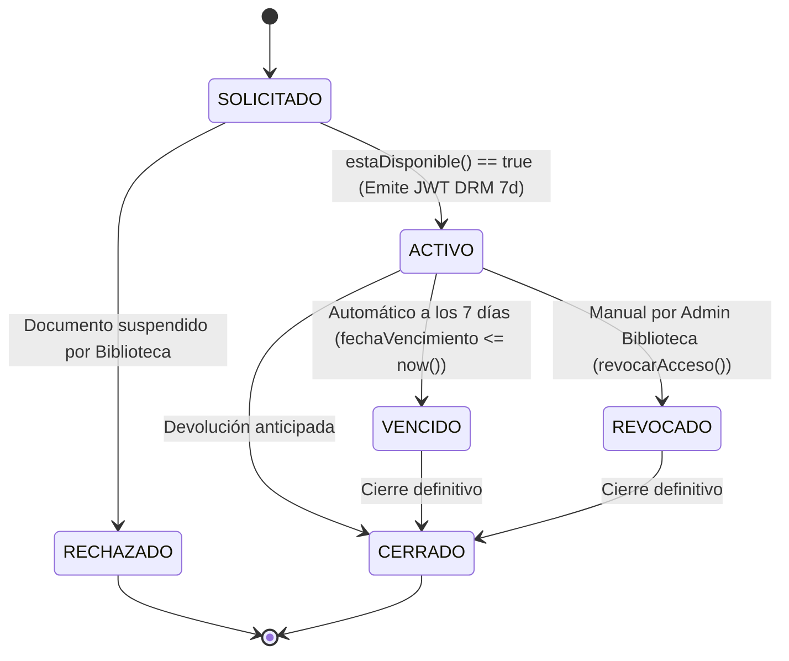

# Fase 4: Módulo de Préstamos, Máquina de Estados y DRM Temporal de 7 Días (RF03, RF04, RNF02)

**Estado:** Completada y Verificada ✅  
**Responsable técnico:** Backend & DBA (Luciano Reguera)

---

## 1. Objetivo de la Fase
Implementar el núcleo operativo del **Sistema de Préstamo Digital Interdepartamental (FAUD-UNSJ)**: la solicitud de préstamo digital concurrente (`RF03`), la **Máquina de Estados explícita** del **Diagrama de Estados (Figura 5)**, la emisión de tokens JWT firmados específicamente para DRM con expiración a **7 días corridos** (`RF04`), la revocación manual inmediata por parte de Biblioteca y el **endpoint protegido de visualización de PDFs (`RNF02`)** con doble verificación (JWT + PostgreSQL) y marca de agua dinámica.

---

## 2. Máquina de Estados Explícita (`LoanStateMachine` — Figura 5)

Ubicación: `backend/src/loans/loan-state-machine.ts`

Se implementó la máquina de estados determinista que gobierna todas las transiciones posibles de la entidad `Prestamo`:

- **Regla de lectura (`allowsReading`)**: Únicamente el estado `ACTIVO` con `fechaVencimiento > now()` autoriza la transmisión del flujo PDF hacia el visor.
- **Bloqueo de reactivación**: Ningún préstamo en estado `VENCIDO`, `REVOCADO`, `RECHAZADO` o `CERRADO` puede volver a `ACTIVO`. Cualquier intento inválido lanza `409 ConflictException`.

---

## 3. Doble Verificación DRM y Marca de Agua Dinámica (Figura 3 — Spec 03)

Ubicación: `backend/src/loans/loans.service.ts` y `backend/src/loans/drm-stream.util.ts`

1. **Emisión del Token DRM (`solicitarPrestamo`)**:
   - Al otorgarse el préstamo, se calcula `fechaVencimiento = fechaInicio + 7 días` (`LOAN_DURATION_DAYS=7`).
   - Se firma un JWT dedicado (`type: 'LOAN_DRM_7D'`) empleando el secreto exclusivo `LOAN_DRM_JWT_SECRET`, incluyendo `sub` (`usuarioId`), `prestamoId`, `documentoId` (`docId`), `codigoReferencia` y `marcaAgua`.
2. **Doble Comprobación en Visualización (`GET /api/v1/documentos/:id/ver` y `GET /api/v1/prestamos/:id/contenido`)**:
   - **Nivel 1 (Criptográfico)**: Verifica la firma y vigencia del JWT DRM (o token de sesión del titular).
   - **Nivel 2 (Persistencia en PostgreSQL - `validarVigencia()`)**: Comprueba en tiempo real que el registro `Prestamo` continúe en estado `ACTIVO` y con `fechaVencimiento > now()`.
   - Si el plazo de 7 días expiró o un Administrador ejecutó `revocarAcceso()`, el endpoint bloquea inmediatamente el acceso devolviendo **`403 Forbidden`** con el mensaje `"El préstamo ha vencido o fue revocado"`, incluso si el token JWT original aún no alcanzó su fecha `exp`.
3. **Encabezados de Protección DRM y Marca de Agua (`buildProtectedPdfStream`)**:
   - Entrega el stream con `Content-Type: application/pdf`, `Content-Disposition: inline`, `Cache-Control: no-store, no-cache, must-revalidate, private`.
   - Inyecta encabezados para el Visor Protegido (Figma pág. 14):
     - `X-DRM-Watermark`: `"Ana Pérez · Préstamo #1024"`
     - `X-DRM-Loan-Code`: `"#1024"`
     - `X-DRM-Expires-At`, `X-DRM-Remaining-Days`, `X-DRM-Remaining-Hours`
     - `X-DRM-Allow-Download: false`, `X-DRM-Allow-Print: false`, `X-DRM-Allow-Copy: false`

---

## 4. Endpoints Implementados en `LoansModule` (`src/loans/`)

| Método | Endpoint | Acceso | Descripción |
| :--- | :--- | :--- | :--- |
| `POST` | `/api/v1/prestamos` | Autenticado (`USUARIO` / `ADMIN`) | Verifica `estaDisponible()`, crea el préstamo en estado `ACTIVO` por 7 días corridos, emite el `tokenAcceso` JWT DRM y registra la notificación `PRESTAMO_OTORGADO`. |
| `GET` | `/api/v1/prestamos/mis-prestamos` | Autenticado | Lista los préstamos del usuario autenticado (Figma pág. 13) con contadores (`activos`, `porVencer24h`, `vencidos`, `revocados`), días/horas restantes y `tokenAcceso` de préstamos vigentes. |
| `GET` | `/api/v1/prestamos` | `ADMINISTRADOR` | Tablero de control de Biblioteca (Figma pág. 9) con métricas operativas (`activos`, `porVencer24h`, `vencidosHoy`, `vencidosTotal`, `revocadosTotal`) y listado paginado filtrable por departamento, estado, usuario o documento. |
| `GET` | `/api/v1/prestamos/:id` | Titular o `ADMINISTRADOR` | Obtiene el detalle completo de un préstamo específico por su UUID. |
| `PATCH` | `/api/v1/prestamos/:id/revocar` | `ADMINISTRADOR` | Ejecuta `revocarAcceso()`, cambia el estado a `REVOCADO`, registra la notificación `PRESTAMO_REVOCADO` e invalida en el acto la visualización del PDF. |
| `PATCH` | `/api/v1/prestamos/:id/cerrar` | Titular o `ADMINISTRADOR` | Finaliza/archiva un préstamo pasándolo al estado terminal `CERRADO`. |
| `GET` | `/api/v1/prestamos/:id/visor` | Token DRM / Titular | Devuelve el JSON de metadatos para el Visor Protegido (Figma pág. 14): documento, cuenta regresiva, marca de agua dinámica y banderas de bloqueo. |
| `GET` | `/api/v1/documentos/:id/ver` | Token DRM / Titular | **Endpoint principal del Diagrama de Secuencia (Figura 3)**: valida vigencia doble y transmite el stream binario protegido del PDF (`200 OK` o `403 Forbidden`). |
| `GET` | `/api/v1/prestamos/:id/contenido` | Token DRM / Titular | Endpoint alternativo por UUID de préstamo para transmisión del stream binario protegido del PDF. |

---

## 5. Criterios de Aceptación (Verificación de Fase 4)
- [x] `LoanStateMachine` valida todas las transiciones del Diagrama de Estados (Figura 5) y bloquea transiciones ilegales con `409 Conflict`.
- [x] `POST /api/v1/prestamos` permite préstamos simultáneos multiusuario sobre un mismo documento, bloquea duplicados activos del mismo usuario y firma el `tokenAcceso` DRM a 7 días.
- [x] `GET /api/v1/prestamos/mis-prestamos` y `GET /api/v1/prestamos` entregan contadores, alerta temprana de 24h (`porVencer24h`) y métricas para el panel de Biblioteca.
- [x] `GET /api/v1/documentos/:id/ver` y `GET /api/v1/prestamos/:id/contenido` entregan el stream PDF con encabezados `X-DRM-Watermark` cuando el préstamo está vigente (`200 OK`).
- [x] `PATCH /api/v1/prestamos/:id/revocar` y el vencimiento a los 7 días bloquean inmediatamente la visualización respondiendo `403 Forbidden` (`"El préstamo ha vencido o fue revocado"`).
- [x] Pruebas unitarias (`loans.service.spec.ts`) y pruebas End-to-End (`test/app.e2e-spec.ts`) ejecutadas en verde.
