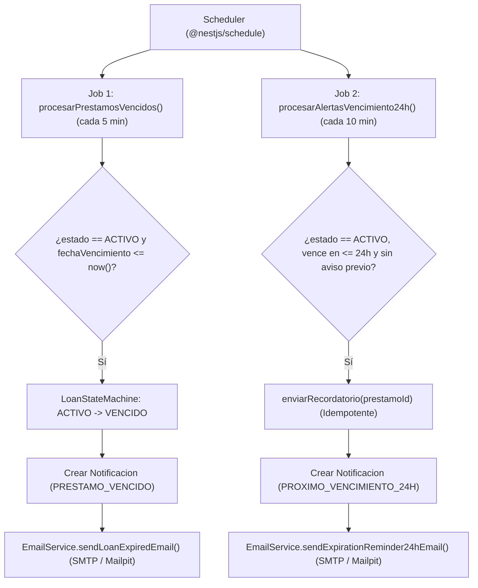

# Fase 5: Módulo de Notificaciones y Tareas Programadas (RF06)

**Estado:** Completada y Verificada ✅  
**Responsable técnico:** Backend & DBA (Luciano Reguera)

---

## 1. Objetivo de la Fase
Implementar el **Módulo de Notificaciones y Tareas Programadas (`NotificationsModule`)** empleando `@nestjs/schedule` y `nodemailer` (integrado con **Mailpit** en el entorno Docker local), cumpliendo con el requerimiento funcional **`RF06`** (envío de recordatorio automático 24 horas antes del vencimiento del préstamo), el **Diagrama de Actividades de Control Continuo de Vigencia (Figura 4)**, el método `enviarRecordatorio()` del **Diagrama de Clases (Figura 2)** y la bandeja de notificaciones en plataforma.

---

## 2. Tareas Programadas (`@nestjs/schedule`) y Control Continuo de Vigencia (Figura 4)

Ubicación: `backend/src/notifications/notifications.service.ts`

1. **Job de Vencimiento Automático (`handleCronVencimientosAutomaticos` / `procesarPrestamosVencidos`)**:
   - Se ejecuta cada **5 minutos** (`CronExpression.EVERY_5_MINUTES`).
   - Busca préstamos en estado `ACTIVO` cuya `fechaVencimiento <= now()` (y préstamos vencidos aún no notificados).
   - Valida la transición con `LoanStateMachine.assertTransition(EstadoPrestamo.ACTIVO, EstadoPrestamo.VENCIDO)` y actualiza el registro a `VENCIDO`.
   - Crea de forma idempotente la entidad `Notificacion` con `tipo = PRESTAMO_VENCIDO` y despacha el correo de cierre del préstamo vía SMTP.
2. **Job de Alerta Temprana 24h (`handleCronAlertasTempranas24h` / `procesarAlertasVencimiento24h`)**:
   - Se ejecuta cada **10 minutos** (`CronExpression.EVERY_10_MINUTES`).
   - Busca préstamos en estado `ACTIVO` con `now() < fechaVencimiento <= now() + 24 horas` que no posean aún una notificación `PROXIMO_VENCIMIENTO_24H`.
   - Invoca el método de dominio **`enviarRecordatorio(prestamoId)`** (Figura 2), que persiste la notificación `PROXIMO_VENCIMIENTO_24H` (`leida = false`) y envía el correo electrónico de recordatorio (`RF06`).

---

## 3. Servicio de Correo Electrónico (`EmailService` — SMTP / Mailpit)

Ubicación: `backend/src/notifications/email.service.ts`

- Conectado por defecto al contenedor Docker **`faud_mailpit`** (`SMTP_HOST=localhost`, `SMTP_PORT=1025`, interfaz web en `http://localhost:8025`).
- Plantillas institucionales en HTML y texto plano para todo el ciclo de vida:
  - `sendExpirationReminder24hEmail()` (`PROXIMO_VENCIMIENTO_24H` — `RF06`)
  - `sendLoanExpiredEmail()` (`PRESTAMO_VENCIDO`)
  - `sendLoanGrantedEmail()` (`PRESTAMO_OTORGADO` — integrado con `LoansService.solicitarPrestamo`)
  - `sendLoanRevokedEmail()` (`PRESTAMO_REVOCADO` — integrado con `LoansService.revocarAcceso`)
  - `sendAccountValidationEmail()` (`CUENTA_APROBADA` — integrado con `UsersService.updateStatus`)
- Diseño resiliente: si el servidor SMTP externo no responde en un entorno aislado, registra la advertencia sin interrumpir la transacción en PostgreSQL.

---

## 4. Endpoints Implementados en `NotificationsModule` (`src/notifications/`)

| Método | Endpoint | Acceso | Descripción |
| :--- | :--- | :--- | :--- |
| `GET` | `/api/v1/notificaciones` | Autenticado (`USUARIO` / `ADMIN`) | Lista paginada de las notificaciones del usuario autenticado filtrable por `leida`, `tipo` o `prestamoId`, incluyendo contadores (`total`, `noLeidas`, `leidas`, `porTipo`). |
| `GET` | `/api/v1/notificaciones/admin` | `ADMINISTRADOR` | Auditoría global paginada de todas las notificaciones emitidas en el sistema, filtrable por `usuarioId`, `prestamoId`, `tipo` y `leida`. |
| `GET` | `/api/v1/notificaciones/:id` | Titular o `ADMINISTRADOR` | Obtiene el detalle de una notificación específica junto con el resumen de su préstamo y documento académico. |
| `PATCH` | `/api/v1/notificaciones/:id/leida` | Titular o `ADMINISTRADOR` | Marca una notificación específica como leída (`leida = true`). |
| `PATCH` | `/api/v1/notificaciones/marcar-todas-leidas` | Autenticado | Marca como leídas todas las notificaciones pendientes del usuario autenticado. |
| `POST` | `/api/v1/notificaciones/ejecutar-control-vigencia` | `ADMINISTRADOR` | Dispara bajo demanda el ciclo completo del Diagrama de Actividades (Figura 4): vencimientos automáticos + alertas de 24h (`enviarRecordatorio()`), retornando el resumen de préstamos procesados y correos enviados. |

---

## 5. Criterios de Aceptación (Verificación de Fase 5)
- [x] `@nestjs/schedule` configurado con los Jobs periódicos de vencimiento automático y alerta temprana de 24 horas (`RF06`).
- [x] Los préstamos en estado `ACTIVO` con `fechaVencimiento <= now()` pasan automáticamente a `VENCIDO` y registran la notificación `PRESTAMO_VENCIDO`.
- [x] Los préstamos en estado `ACTIVO` que vencen en las próximas 24 horas generan una única notificación `PROXIMO_VENCIMIENTO_24H` mediante `enviarRecordatorio()` (idempotente) y despachan el correo en Mailpit (`localhost:1025`).
- [x] `GET /api/v1/notificaciones`, `PATCH /api/v1/notificaciones/:id/leida` y `PATCH /api/v1/notificaciones/marcar-todas-leidas` operativos y protegidos por titularidad.
- [x] Pruebas unitarias (`notifications.service.spec.ts`) y pruebas End-to-End (`test/app.e2e-spec.ts`) ejecutadas en verde.
