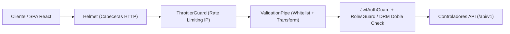

# Fase 6: Pruebas Integrales (Unitarias + E2E), Seguridad (Hardening) y Cierre del Backend

**Estado:** Completada y Verificada ✅  
**Responsable técnico:** Backend & DBA (Luciano Reguera)

---

## 1. Objetivo de la Fase
Certificar que el **Backend del Sistema de Préstamo Digital Interdepartamental (FAUD-UNSJ)** cumple con el 100% de los requerimientos funcionales (`RF01`–`RF06`), no funcionales (`RNF01`–`RNF02`), diagramas UML (Figuras 1 a 7) y contratos para el prototipo de Figma, incorporando el endurecimiento de seguridad HTTP (`helmet`), protección contra ataques de fuerza bruta (`@nestjs/throttler`), cobertura integral de pruebas automatizadas (Unitarias + E2E) y exportación del contrato congelado **`openapi.json`** (Etapa B).

---

## 2. Arquitectura de Seguridad y Hardening (`Helmet` + `@nestjs/throttler`)

Ubicación:
- `backend/src/common/bootstrap/security-and-pipes.config.ts`
- `backend/src/app.module.ts`
- `backend/src/auth/auth.controller.ts`



### 2.1. Endurecimiento de Cabeceras HTTP (`helmet`)
- **`X-Content-Type-Options: nosniff`**: Impide la inferencia peligrosa de tipos MIME por parte del navegador.
- **`X-Frame-Options: SAMEORIGIN`** y **`Content-Security-Policy` (`frame-ancestors`)**: Protege contra ataques de *Clickjacking*, autorizando únicamente al origen del propio sistema y al visor protegido del Frontend (`CORS_ORIGIN`).
- **`Referrer-Policy: no-referrer`**: Evita que URLs o tokens viajen en cabeceras `Referer` hacia sitios externos.
- **`X-DNS-Prefetch-Control: off`** y **`X-Download-Options: noopen`**.
- **Ocultamiento de `X-Powered-By`**: Remueve la huella tecnológica de Express/Node.js.
- **CORS Estricto con Exposición Controlada**: Expone explícitamente los encabezados de DRM (`X-DRM-Watermark`, `X-DRM-Loan-Code`, `X-DRM-Remaining-Days`, etc.) y de Rate Limiting (`X-RateLimit-Limit`, `X-RateLimit-Remaining`, `X-RateLimit-Reset`, `Retry-After`).

### 2.2. Rate Limiting y Protección contra Fuerza Bruta (`@nestjs/throttler`)
- **Límite Global (`default`)**: `100` peticiones por minuto (`THROTTLE_TTL_MS=60000`, `THROTTLE_LIMIT=100`) por dirección IP (`X-Forwarded-For` / `req.ip`).
- **Límite Estricto en Autenticación (`POST /api/v1/auth/login` y `POST /api/v1/auth/register`)**: `15` intentos por ventana de 60 segundos (`@Throttle({ default: { limit: 15, ttl: 60000 } })`). Al superar el umbral, el servidor responde inmediatamente con **`429 Too Many Requests`** y cabecera `Retry-After`.

---

## 3. Suite de Pruebas Automatizadas (Unitarias + End-to-End)

### 3.1. Pruebas Unitarias (Jest — `backend/src/**/*.spec.ts`)
| Suite de Pruebas | Lógica Crítica Evaluada |
| :--- | :--- |
| `loans.service.spec.ts` | **`LoanStateMachine`** (transiciones legales, bloqueo de reactivaciones con `409 Conflict`, estados terminales `RECHAZADO` y `CERRADO`, `allowsReading()`), **`solicitarPrestamo()`** (emisión de JWT DRM 7 días y marca de agua), **`validarVigencia()`** (transición automática a `VENCIDO` si `fechaVencimiento <= now()`), **`revocarAcceso()`** (corte inmediato de vigencia), **`cerrarPrestamo()`**, **`validateDrmAccessByDocument()`** y **`extractDrmTokenFromRequest()`**. |
| `catalog.service.spec.ts` | **`estaDisponible()`** (préstamos simultáneos multiusuario, bloqueo de duplicados activos del mismo usuario, suspensión administrativa `disponible = false`), **`PdfStorageService`** (validación de firma binaria `%PDF-`, extensión `.pdf` y límite de `50 MB`) y buscador con filtros combinados. |
| `notifications.service.spec.ts` | **`procesarPrestamosVencidos()`**, **`procesarAlertasVencimiento24h()`**, **`enviarRecordatorio()`** (idempotencia de avisos de 24h — `RF06`) y control de titularidad en bandeja de notificaciones. |
| `auth.service.spec.ts` | Registro departamental en estado `PENDIENTE`, hash `bcrypt`, bloqueo de login `403 Forbidden` para cuentas `PENDIENTE`/`RECHAZADO` y emisión de JWT para cuentas `APROBADO` (`RF05`). |
| `users.service.spec.ts` | Contadores por pestaña (`todos`, `pendientes`, `aprobados`, `rechazados`), aprobación/rechazo por Biblioteca y protección contra auto-rechazo de cuenta Admin. |
| `departments.service.spec.ts` | Ordenamiento de los 19 departamentos de San Juan (`Capital` primero) y métricas territoriales. |
| `env.validation.spec.ts` | Validación tipada de variables de entorno obligatorias y valores por defecto de seguridad (`THROTTLE_*`, `LOAN_DURATION_DAYS`). |
| `health.controller.spec.ts` & `prisma.service.spec.ts` | Estado operativo del servicio y conexión a PostgreSQL. |

### 3.2. Pruebas End-to-End (Supertest — `backend/test/app.e2e-spec.ts`)
Cubren de forma secuencial las **Fases 0 a 6**, incluyendo el circuito integral de certificación final:
1. **Registro y aprobación de usuario departamental** (estudiante de Calingasta/Jáchal en estado `PENDIENTE` -> bloqueo de login `403` -> aprobación por Administrador -> login exitoso con JWT).
2. **Carga de documento PDF por Administrador** (`POST /api/v1/documentos` con validación de magic bytes `%PDF-` y almacenamiento privado).
3. **Búsqueda pública combinada y solicitud de préstamo temporal** (`GET /api/v1/documentos` + `POST /api/v1/prestamos` con emisión de `tokenAcceso` DRM a 7 días y marca de agua dinámica).
4. **Acceso autorizado al documento con token válido (`200 OK`)** (`GET /api/v1/documentos/:id/ver` verificando stream `%PDF-` y cabeceras `X-DRM-Watermark`).
5. **Bloqueo inmediato de acceso con préstamo vencido o revocado (`403 Forbidden`)** (`PATCH /api/v1/prestamos/:id/revocar` y expiración de 7 días).
6. **Verificación de Hardening (`Helmet` + `Rate Limiting 429`)** y **Contrato OpenAPI 3.0 (`/api/docs-json`)**.

---

## 4. Congelamiento y Exportación del Contrato OpenAPI 3.0 (`openapi.json`)

Comando de exportación:
```bash
cd backend
pnpm run openapi:export
```

Archivos generados y sincronizados (26 rutas y 50 esquemas DTO):
- `backend/openapi.json`
- `docs/specs/openapi.json`
- Endpoint en vivo: `GET http://localhost:3000/api/docs-json` y Swagger UI en `http://localhost:3000/api/docs`

---

## 5. Matriz de Trazabilidad y Cierre del Backend (RF01–RF06 y RNF01–RNF02)

| Código | Requerimiento | Módulo / Implementación | Estado |
| :--- | :--- | :--- | :--- |
| **RF01** | Carga y catalogación de documentos PDF (máx. 50 MB) con metadatos normalizados. | `CatalogModule` + `PdfStorageService` (`POST/PATCH/DELETE /api/v1/documentos`) | ✅ Cumplido |
| **RF02** | Búsqueda pública por palabras clave, autor, año, tipo, carrera y departamento. | `CatalogModule` (`GET /api/v1/documentos`, `GET /api/v1/documentos/:id`) | ✅ Cumplido |
| **RF03** | Solicitud de préstamo digital temporal por 7 días con disponibilidad concurrente. | `LoansModule` (`POST /api/v1/prestamos`, `estaDisponible()`, `LoanStateMachine`) | ✅ Cumplido |
| **RF04** | Visor protegido con DRM temporal (JWT 7d), marca de agua dinámica y bloqueo al vencer/revocar. | `LoansModule` + `DocumentViewerController` (`GET /api/v1/documentos/:id/ver`) | ✅ Cumplido |
| **RF05** | Registro por departamento (19 deptos. de San Juan), validación por Biblioteca y Auth JWT. | `AuthModule` + `UsersModule` + `DepartmentsModule` | ✅ Cumplido |
| **RF06** | Notificaciones automáticas 24h antes del vencimiento (`enviarRecordatorio()`) y vencimiento por Cron. | `NotificationsModule` + `EmailService` (`@nestjs/schedule` + Mailpit) | ✅ Cumplido |
| **RNF01** | Interfaz API RESTful estandarizada, paginada, documentada en OpenAPI 3.0 y lista para SPA. | `@nestjs/swagger` (`docs/specs/openapi.json`) + `ValidationPipe` | ✅ Cumplido |
| **RNF02** | Seguridad de archivos PDF (almacenamiento fuera de carpeta pública, Helmet, Rate Limiting y doble validación DRM). | `PdfStorageService` + `Helmet` + `ThrottlerGuard` + Doble Check JWT/PostgreSQL | ✅ Cumplido |
