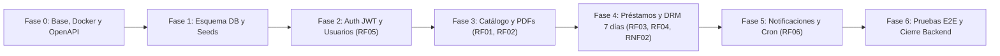

# Plan de Fases de Implementación — Backend (NestJS + PostgreSQL)

Este documento detalla la hoja de ruta incremental para construir y verificar el **Backend del Sistema de Préstamo Digital Interdepartamental (FAUD-UNSJ)** antes de iniciar el desarrollo del Frontend.

Cada fase tendrá su propio documento de seguimiento en `docs/backend/fase-XX-*.md` y su especificación en `docs/specs/`.

---

## Resumen de Fases del Backend

---

## Fase 0: Inicialización, Infraestructura Local y Estándares
**Objetivo:** Dejar operativo el esqueleto del proyecto NestJS conectado a PostgreSQL en Docker, con validación global y documentación OpenAPI lista.

- **Entregables técnicos:**
  - `docker-compose.yml` en la raíz con **PostgreSQL 16** (y opcionalmente **Mailpit** para capturar correos de prueba localmente sin configurar cuentas reales).
  - Inicialización del proyecto en `backend/` con **NestJS + TypeScript** utilizando **`pnpm`** como gestor de paquetes (`nest new backend --package-manager pnpm`).
  - Configuración de variables de entorno tipadas (`@nestjs/config` + validación de `.env`).
  - Configuración global de `ValidationPipe` (`class-validator` / `class-transformer`), prefijo `/api/v1` y CORS.
  - Configuración de **Swagger / OpenAPI** en `/api/docs`.
  - Endpoint `/api/v1/health` para chequeo de estado y conexión a la base de datos.
- **Criterio de validación:** Contenedor de Postgres arriba, servidor NestJS corriendo sin errores y Swagger UI accesible en `http://localhost:3000/api/docs`.

---

## Fase 1: Modelado de Datos, Migraciones y Semillas (Seeds)
**Objetivo:** Implementar el esquema relacional en PostgreSQL respetando el DER de la Segunda Etapa y los campos de los prototipos de Figma.

- **Entregables técnicos:**
  - Configuración de **Prisma ORM** (`prisma/schema.prisma` y `PrismaModule` global en NestJS).
  - Regla de negocio de disponibilidad (`estaDisponible()`): **Préstamos simultáneos multiusuario** (varios usuarios pueden tener préstamos `ACTIVO` del mismo documento a la vez; solo se valida que el documento esté habilitado por Biblioteca `disponible = true` y que el mismo usuario no tenga ya un préstamo `ACTIVO` vigente sobre ese documento).
  - Definición de enumerados en base de datos:
    - `RolUsuario`: `USUARIO`, `ADMINISTRADOR`
    - `EstadoValidacionUsuario`: `PENDIENTE`, `APROBADO`, `RECHAZADO`
    - `TipoDocumento`: `TESIS`, `MONOGRAFIA`, `INVESTIGACION`, `OTROS`
    - `EstadoPrestamo`: `SOLICITADO`, `ACTIVO`, `RECHAZADO`, `VENCIDO`, `REVOCADO`, `CERRADO`
    - `TipoNotificacion`: `CUENTA_APROBADA`, `PRESTAMO_ACTIVO`, `POR_VENCER_24H`, `PRESTAMO_VENCIDO`, `PRESTAMO_REVOCADO`
  - Creación de tablas con claves primarias UUID e índices de búsqueda:
    - `departamentos`
    - `usuarios`
    - `documentos`
    - `prestamos`
    - `notificaciones`
  - **Script de Seed (`seed.ts`)**:
    - Carga de los **19 departamentos de San Juan** (`Capital` con `esCapital = true`, y los 18 departamentos restantes como `Jáchal`, `Valle Fértil`, `Iglesia`, `Calingasta`, `Sarmiento`, etc. con `esCapital = false`).
    - Usuario Administrador inicial (`admin@faud.unsj.edu.ar`) y usuarios de prueba de distintos departamentos.
    - Documentos académicos de ejemplo alineados con los prototipos de Figma.
- **Criterio de validación:** Migraciones ejecutadas en PostgreSQL y base de datos poblada con el seed inicial.

---

## Fase 2: Módulo de Departamentos, Autenticación (JWT) y Gestión de Usuarios (RF05)
**Objetivo:** Resolver el registro de usuarios por departamento, la validación por parte del Administrador de Biblioteca y el inicio de sesión seguro.

- **Entregables técnicos:**
  - **`DepartmentsModule`**:
    - `GET /api/v1/departamentos`: Listado público de los 19 departamentos para el formulario de registro y filtros del catálogo, más métricas de distribución territorial.
  - **`AuthModule`**:
    - `POST /api/v1/auth/register`: Registro de usuario con contraseña hasheada (`bcrypt`/`argon2`), asociado a su departamento y con estado inicial `PENDIENTE`.
    - `POST /api/v1/auth/login`: Autenticación de credenciales. Verifica que el usuario esté `APROBADO` antes de emitir el token JWT de sesión.
    - `GET /api/v1/auth/profile`: Datos del usuario autenticado.
    - `JwtAuthGuard` y `RolesGuard` (`@Roles(RolUsuario.ADMINISTRADOR)`).
  - **`UsersModule` (Panel Admin Biblioteca)**:
    - `GET /api/v1/usuarios`: Listado filtrable por estado (`PENDIENTE`, `APROBADO`, `RECHAZADO`) y departamento, con contadores para las pestañas del panel Admin (visto en Figma pág. 8).
    - `PATCH /api/v1/usuarios/:id/estado`: Aprobar o rechazar la cuenta de un usuario de cualquier departamento.
- **Criterio de validación:** Flujo completo probado en Swagger: registro de alumno de Jáchal -> intento de login bloqueado por estar pendiente -> aprobación por Admin -> login exitoso con JWT.

---

## Fase 3: Módulo de Catálogo y Almacenamiento Seguro de PDFs (RF01, RF02)
**Objetivo:** Permitir al Administrador cargar y catalogar documentos PDF con metadatos normalizados, y ofrecer el buscador público con todos los filtros.

- **Entregables técnicos:**
  - **`CatalogModule` (`Documentos`)**:
    - Almacenamiento privado de archivos PDF (fuera de una carpeta pública estática, para que ningún usuario pueda descargar el PDF mediante una URL directa sin pasar por el control de préstamo). Validación de formato `.pdf` y tamaño máximo `50 MB`.
    - `POST /api/v1/documentos` (Solo Admin, `multipart/form-data`): Carga del PDF y metadatos (`titulo`, `autor`, `director`, `carrera`, `tipo`, `anio`, `departamentoOrigenId`, `palabrasClave[]`, `resumen`).
    - `PATCH /api/v1/documentos/:id` y `DELETE /api/v1/documentos/:id` (Solo Admin).
    - `GET /api/v1/documentos` (Público): Buscador paginado con filtros combinables:
      - `q` (búsqueda por texto en título, autor o palabras clave)
      - `departamentoId`
      - `carrera`
      - `tipo`
      - `anioDesde` / `anioHasta`
      - `disponible`
    - `GET /api/v1/documentos/:id` (Público): Detalle completo de la ficha del documento (sin exponer el archivo PDF directo) e indicador `estaDisponible()`.
- **Criterio de validación:** Carga de un PDF desde Swagger, búsqueda con filtros combinados y verificación de que el archivo PDF no es accesible sin préstamo.

---

## Fase 4: Módulo de Préstamos, Máquina de Estados y DRM Temporal (RF03, RF04, RNF02)
**Objetivo:** Implementar el núcleo del sistema: la solicitud de préstamo, la emisión del token JWT de acceso temporal a 7 días, la máquina de estados y el endpoint protegido de visualización.

- **Entregables técnicos:**
  - **`LoansModule` (`Prestamos`)**:
    - Implementación de la **Máquina de Estados** definida en el Diagrama de Estados (Figura 5):
      - `SOLICITADO` -> `ACTIVO` (si disponible) o `RECHAZADO` (si no disponible).
      - `ACTIVO` -> `VENCIDO` (automático a los 7 días) o `REVOCADO` (manual por Admin).
      - Transición a bloqueo definitivo de visualización.
    - `POST /api/v1/prestamos` (Usuario autenticado):
      - Verifica disponibilidad (`estaDisponible()`).
      - Genera el `tokenAcceso` (JWT firmado con secret específico de DRM, `sub: usuarioId`, `docId`, `prestamoId`, `exp: 7d`).
      - Persiste el préstamo en estado `ACTIVO` con `fechaVencimiento = fechaInicio + 7 días` y retorna el préstamo + token.
    - `GET /api/v1/prestamos/mis-prestamos` (Usuario autenticado):
      - Lista los préstamos del alumno agrupados/filtrables por estado (`ACTIVO`, `VENCIDO`, `SOLICITADO`), calculando días restantes y alerta de "Por vencer (24h)" (Figma pág. 13).
    - `GET /api/v1/prestamos` (Admin Biblioteca):
      - Tablero de control con métricas (`Activos`, `Por Vencer 24h`, `Vencidos Hoy`) y listado paginado (Figma pág. 9).
    - `PATCH /api/v1/prestamos/:id/revocar` (Admin Biblioteca):
      - Ejecuta `revocarAcceso()`, cambia el estado a `REVOCADO` e invalida inmediatamente la lectura aunque el JWT no haya expirado.
    - **Endpoint de Visualización Protegida (`GET /api/v1/documentos/:id/ver` o `/api/v1/prestamos/:id/contenido`)**:
      - Implementa el flujo exacto del **Diagrama de Secuencia (Figura 3)**:
      - Verifica la firma y expiración del JWT temporal **y** valida en base de datos que el préstamo siga en estado `ACTIVO` y `fechaVencimiento > now()`.
      - Si está vencido o revocado -> responde `403 Forbidden` (`"El préstamo ha vencido o fue revocado"`).
      - Si está vigente -> entrega el stream seguro del PDF junto con los metadatos de marca de agua dinámica (`"Nombre Apellido · Préstamo #Código"`).
- **Criterio de validación:** Prueba de los caminos `alt` del Diagrama de Secuencia: acceso permitido con token vigente (200 OK) y bloqueo inmediato (403 Forbidden) tras revocación manual o expiración del token.

---

## Fase 5: Módulo de Notificaciones y Tareas Programadas (RF06)
**Objetivo:** Automatizar el control continuo de vigencia (Diagrama de Actividades, Figura 4) y el aviso previo de 24 horas antes del vencimiento.

- **Entregables técnicos:**
  - **`NotificationsModule` + `@nestjs/schedule` (Cron Jobs)**:
    - **Job de Vencimiento Automático (ejecución periódica)**: Busca préstamos en estado `ACTIVO` cuya `fechaVencimiento <= now()`, los pasa automáticamente a `VENCIDO` y genera la notificación de cierre de préstamo.
    - **Job de Alerta Temprana (24h antes)**: Busca préstamos `ACTIVO` que vencen en las próximas 24 horas sin aviso previo enviado, registra la entidad `Notificacion` y envía el correo de recordatorio (`RF06`).
    - Endpoints para consultar y marcar notificaciones como leídas (`GET /api/v1/notificaciones`, `PATCH /api/v1/notificaciones/:id/leida`).
- **Criterio de validación:** Ejecución del servicio de verificación comprobando el cambio automático de estado a `VENCIDO` y el envío del correo en Mailpit / registro en tabla `notificaciones`.

---

## Fase 6: Pruebas Integrales (Unitarias + E2E), Seguridad y Cierre del Backend
**Objetivo:** Certificar que el Backend cumple todos los criterios de aceptación antes de iniciar el Frontend en React.

- **Entregables técnicos:**
  - Pruebas unitarias (Jest) sobre la lógica crítica: `validarVigencia()`, `revocarAcceso()`, `estaDisponible()` y transiciones de estados.
  - Pruebas End-to-End (Supertest) cubriendo el circuito completo:
    1. Registro y aprobación de usuario departamental.
    2. Carga de documento por Administrador.
    3. Búsqueda pública y solicitud de préstamo.
    4. Acceso al documento con token válido (200 OK).
    5. Bloqueo de acceso con préstamo vencido/revocado (403 Forbidden).
  - Hardening básico: `helmet`, Rate Limiting (`@nestjs/throttler`) y exportación del contrato final `openapi.json` para el equipo de Frontend.
