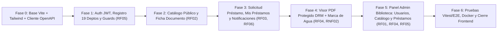

# Plan de Fases de Implementación — Frontend SPA (React + Vite + TypeScript + Tailwind CSS)

Este documento detalla la hoja de ruta incremental (**Etapa C**) para construir, integrar y certificar el **Frontend del Sistema de Préstamo Digital Interdepartamental (FAUD-UNSJ)**, conectándolo contra el Backend NestJS ya finalizado y el contrato congelado [`docs/specs/openapi.json`](file:///c:/Users/Operador/Documents/Luciano/projects/TDS/PPI_IV/docs/specs/openapi.json).

Al igual que en el Backend, cada fase tendrá su propio documento de seguimiento y verificación en `docs/frontend/fase-XX-*.md` y se rige por la especificación [`docs/specs/02-especificacion-frontend-ui-ux-y-drm.md`](file:///c:/Users/Operador/Documents/Luciano/projects/TDS/PPI_IV/docs/specs/02-especificacion-frontend-ui-ux-y-drm.md).

---

## Resumen de Fases del Frontend

---

## Fase 0: Inicialización de la SPA, Design System (Figma) y Cliente HTTP Tipado (Completada ✅)
**Objetivo:** Dejar operativo el esqueleto del proyecto React + Vite + TypeScript en `frontend/` gestionado con **`pnpm`**, con Tailwind CSS configurado según la paleta institucional FAUD-UNSJ, contratos TypeScript alineados con `openapi.json`, cliente HTTP con interceptores y Layout base navegable.

- **Entregables técnicos:**
  - Inicialización en `frontend/` con **React 18 + Vite + TypeScript** utilizando **`pnpm`**.
  - Configuración de **Tailwind CSS**, `lucide-react` e identidad visual de Figma (colores institucionales `#1E3A8A`, `#0F172A`, badges semánticos de estados y tipografía).
  - Definición completa de tipos y enumerados en `src/types/openapi.types.ts` espejados del contrato `docs/specs/openapi.json` (`RolUsuario`, `EstadoValidacionUsuario`, `TipoDocumento`, `EstadoPrestamo`, `TipoNotificacion` y DTOs de las 26 rutas).
  - Configuración de variables de entorno (`.env` / `.env.example` con `VITE_API_BASE_URL=http://localhost:3000/api/v1`) y proxy de desarrollo en `vite.config.ts`.
  - Cliente HTTP centralizado (`src/api/http-client.ts`) con inyección automática de `Authorization: Bearer <token>`, soporte para `x-drm-token`, manejo tipado de errores (`401`, `403`, `409`, `429 Retry-After`) y servicio de notificaciones visuales (`ToastContext`).
  - Layout institucional (`Navbar`, `Footer`, indicador de estado de conexión con `GET /api/v1/health`) y esqueleto de rutas con `react-router-dom`.
- **Criterio de validación:** `pnpm run build` y `pnpm run test` en verde; SPA levantando en `http://localhost:5173` y verificando conectividad en vivo con el Backend (`GET /api/v1/health`).
- **Documento de seguimiento:** [`docs/frontend/fase-00-inicializacion-y-design-system.md`](file:///c:/Users/Operador/Documents/Luciano/projects/TDS/PPI_IV/docs/frontend/fase-00-inicializacion-y-design-system.md).

---

## Fase 1: Autenticación JWT, Registro Interdepartamental (19 Departamentos) y Guardias de Rol (`RF05`) (Completada ✅)
**Objetivo:** Implementar el flujo completo de sesión y registro territorial de la **página 10 de Figma**, contemplando el estado inicial `PENDIENTE` de validación por Biblioteca y la protección de rutas por rol (`USUARIO` vs. `ADMINISTRADOR`).

- **Entregables técnicos:**
  - **`AuthContext` / `useAuth`**: Persistencia segura de sesión JWT, carga automática de perfil (`GET /api/v1/auth/profile`), cierre de sesión y helpers de rol (`isAdmin`, `isAuthenticated`).
  - **Vista de Inicio de Sesión (`/login` — Figma pág. 10)**:
    - Formulario validado contra `POST /api/v1/auth/login`.
    - Manejo específico de respuestas `403 Forbidden` cuando la cuenta se encuentra en estado **`PENDIENTE`** (banner ámbar explicando que aguarda aprobación de Biblioteca FAUD-UNSJ) o **`RECHAZADO`** (banner rojo).
    - Accesos rápidos de demostración (credenciales precargables del seed: Admin Biblioteca, Alumna Aprobada de Jáchal y Usuario Pendiente de Valle Fértil) para agilizar las pruebas y defensa del proyecto.
  - **Vista de Registro Departamental (`/registro` — Figma pág. 10)**:
    - Consume `GET /api/v1/departamentos` para listar los **19 departamentos de San Juan** (`Capital` y los 18 departamentos restantes).
    - Envía `POST /api/v1/auth/register` y muestra pantalla de confirmación informando que la cuenta nació en estado `PENDIENTE`.
  - **Guardias de Navegación (`ProtectedRoute` y `RoleGuard`)**:
    - Redirección a `/login` preservando la ruta de destino (`?redirect=...`) para usuarios no autenticados.
    - Restricción de rutas `/admin/*` exclusivamente a usuarios con `rol === 'ADMINISTRADOR'`.
- **Criterio de validación:** Flujo probado de punta a punta: registro de usuario departamental -> aviso de estado `PENDIENTE` -> bloqueo en `/login` con `403` -> inicio de sesión exitoso con cuenta `APROBADO` y redirección según rol.
- **Documento de seguimiento:** [`docs/frontend/fase-01-autenticacion-y-departamentos.md`](file:///c:/Users/Operador/Documents/Luciano/projects/TDS/PPI_IV/docs/frontend/fase-01-autenticacion-y-departamentos.md).

---

## Fase 2: Catálogo Público Interdepartamental, Buscador Combinado y Ficha Bibliográfica (`RF02`) (Completada ✅)
**Objetivo:** Construir las pantallas públicas de exploración académica (**Figma páginas 11 y 12**), con búsqueda multicriterio en tiempo real, métricas de alcance en los 19 departamentos y vista detallada del documento.

- **Entregables técnicos:**
  - **Vista de Catálogo Público (`/` y `/catalogo` — Figma pág. 11)**:
    - Barra de búsqueda libre (`q`) con *debounce* (busca en título, autor, director, resumen y palabras clave).
    - Panel de filtros combinables sincronizados con la URL (`useSearchParams`):
      - **Departamento de Origen** (los 19 departamentos desde `GET /api/v1/departamentos`).
      - **Carrera** (`Arquitectura`, `Diseño`, `Urbanismo`).
      - **Tipo de Documento** (`TESIS`, `MONOGRAFIA`, `INVESTIGACION`, `OTROS`).
      - **Rango de Año** (`anioDesde`, `anioHasta`) y **Disponibilidad** (`disponible`).
    - Banner de **Alcance Territorial Interdepartamental** consumiendo `GET /api/v1/departamentos/metricas` (destacando documentos catalogados y presencia en Capital + 18 departamentos).
    - Grilla responsiva de tarjetas (`DocumentCard`) con badges de tipo, carrera, departamento, año, etiquetas de palabras clave y estado de disponibilidad (`estaDisponible`).
    - Componente de paginación conectado a `meta` (`page`, `limit`, `total`, `totalPages`).
  - **Vista de Ficha Bibliográfica (`/documentos/:id` — Figma pág. 12)**:
    - Consume `GET /api/v1/documentos/:id` mostrando título completo, autor, director/codirector, carrera, departamento de origen, año, resumen académico completo y chips de palabras clave.
    - Recuadro informativo de **Condiciones de Préstamo Digital y Derechos de Autor (DRM 7 días)**.
    - Botón de acción contextual según sesión y disponibilidad (solicitar préstamo, ir al visor si ya tiene préstamo activo sobre la obra, o iniciar sesión).
- **Criterio de validación:** Navegación pública fluida, filtrado combinado por departamento/carrera/tipo/texto contra `GET /api/v1/documentos` y visualización completa de la ficha bibliográfica sin exponer URLs directas al PDF.
- **Documento de seguimiento:** [`docs/frontend/fase-02-catalogo-publico-y-ficha.md`](file:///c:/Users/Operador/Documents/Luciano/projects/TDS/PPI_IV/docs/frontend/fase-02-catalogo-publico-y-ficha.md).

---

## Fase 3: Solicitud de Préstamo, Panel `"Mis Préstamos"` y Bandeja de Notificaciones (`RF03`, `RF06`) (Completada ✅)
**Objetivo:** Implementar la experiencia completa del estudiante/docente autenticado (**Figma página 13**): solicitud de préstamo concurrente por 7 días, seguimiento de vigencia con alerta temprana de 24h y centro de notificaciones.

- **Entregables técnicos:**
  - **Flujo de Solicitud de Préstamo (`RequestLoanModal` + `POST /api/v1/prestamos`)**:
    - Modal de confirmación que detalla la vigencia de **7 días corridos**, la generación del token temporal DRM y la marca de agua nominal.
    - Al confirmar (`201 Created`), muestra el código asignado (ej. `#1024`), guarda la referencia del `tokenAcceso` y permite abrir directamente el **Visor Protegido** (`/visor/:prestamoId`).
    - Manejo claro de `409 Conflict` si el usuario ya posee un préstamo `ACTIVO` sobre ese mismo documento o si el documento fue suspendido por Biblioteca.
  - **Panel `"Mis Préstamos"` (`/mis-prestamos` — Figma pág. 13)**:
    - Consume `GET /api/v1/prestamos/mis-prestamos`.
    - Pestañas con contadores dinámicos: `Activos (N)`, `Por Vencer 24h (N)`, `Vencidos / Historial (N)` y `Todos (N)`.
    - Tarjetas de préstamo (`LoanCard`) con:
      - Código `#1024`, datos de la obra, fecha de otorgamiento y fecha de vencimiento.
      - Indicador visual de tiempo restante (`diasRestantes` d / `horasRestantes` h) y badge de alerta ámbar cuando `porVencer24h === true` (`RF06`).
      - Botón primario **`"Abrir en Visor Protegido"`** (para préstamos `ACTIVO` vigentes).
      - Botón secundario **`"Devolver / Cerrar Préstamo"`** (`PATCH /api/v1/prestamos/:id/cerrar`) para devolución anticipada o archivo de préstamos vencidos.
  - **Bandeja y Campana de Notificaciones (`NotificationBell` + `/notificaciones` — `RF06`)**:
    - Indicador en la barra superior con el contador `noLeidas` (`GET /api/v1/notificaciones`).
    - Listado filtrable por estado (`Todas`, `No leídas`, `Leídas`) y por tipo (`PRESTAMO_OTORGADO`, `PROXIMO_VENCIMIENTO_24H`, `PRESTAMO_VENCIDO`, `PRESTAMO_REVOCADO`, `CUENTA_APROBADA`).
    - Acciones para marcar una notificación como leída (`PATCH /api/v1/notificaciones/:id/leida`) o todas a la vez (`PATCH /api/v1/notificaciones/marcar-todas-leidas`).
- **Criterio de validación:** Solicitud de préstamo desde la ficha del documento, visualización inmediata en `/mis-prestamos` con cuenta regresiva de 7 días, recepción de la notificación `PRESTAMO_OTORGADO` y devolución anticipada funcional.
- **Documento de seguimiento:** [`docs/frontend/fase-03-prestamos-usuario-y-notificaciones.md`](file:///c:/Users/Operador/Documents/Luciano/projects/TDS/PPI_IV/docs/frontend/fase-03-prestamos-usuario-y-notificaciones.md).

---

## Fase 4: Visor PDF Protegido con DRM Temporal (7 Días) y Marca de Agua Dinámica (`RF04`, `RNF02`) (Completada ✅)
**Objetivo:** Implementar el **Visor Protegido (`/visor/:prestamoId` — Figma página 14 y Diagrama de Secuencia Figura 3)** con renderizado en `<canvas>`, marca de agua dinámica superpuesta, bloqueo de descarga/impresión/copia y corte inmediato ante vencimiento o revocación (`403 Forbidden`).

- **Entregables técnicos:**
  - **Integración con el Flujo de Doble Validación DRM (Figura 3)**:
    - Consulta inicial a `GET /api/v1/prestamos/:id/visor` enviando el token DRM (`x-drm-token` y `Authorization`) para obtener metadatos en vivo (`marcaAgua`, `segundosRestantes`, restricciones DRM y datos bibliográficos).
    - Descarga autenticada en memoria (`ArrayBuffer`) desde `GET /api/v1/documentos/:documentoId/ver` (y respaldo `/api/v1/prestamos/:id/contenido`), leyendo además las cabeceras expuestas por CORS (`X-DRM-Watermark`, `X-DRM-Loan-Code`, `X-DRM-Remaining-Days`).
  - **Renderizador Seguro en `<canvas>` (`ProtectedPdfCanvas` con `pdfjs-dist`)**:
    - Renderiza las páginas del documento directamente sobre elementos `<canvas>` sin utilizar `<iframe>` ni `<embed>` nativos del navegador (eliminando de raíz el botón nativo de descarga/impresión del navegador).
    - Barra superior oscura (**Figma pág. 14**) con: botón de regreso a `/mis-prestamos`, título y autor de la obra, código `#1024`, paginación (`Página X de Y`), controles de zoom (`-`, `100%`, `+`, ajustar ancho) y reloj de cuenta regresiva en vivo.
  - **Marca de Agua Dinámica Superpuesta (`DynamicWatermark`)**:
    - Capa superpuesta en mosaico diagonal e inalterable sobre cada página renderizada con el texto exacto del préstamo:
      > `"Ana Pérez · Préstamo #1024 · FAUD-UNSJ"`
  - **Escudo Antidescarga / Antiimpresión (`DrmSecurityShield` — `RNF02`)**:
    - Deshabilitación de clic derecho (`contextmenu`), selección de texto (`user-select: none`), arrastrar imagen (`draggable="false"`) y atajos `Ctrl+S`, `Ctrl+P`, `Ctrl+C`.
    - Regla `@media print` que oculta el contenido del visor si se invoca la impresión del sistema operativo.
  - **Pantalla de Bloqueo Inmediato (`403 Forbidden`)**:
    - Revalidación periódica de vigencia en segundo plano y al cambiar de página.
    - Si el préstamo vence o es revocado manualmente por un Administrador desde `/admin/prestamos`, el visor destruye el buffer del PDF en memoria y presenta en el acto la pantalla **`"Acceso Bloqueado: El préstamo ha vencido o fue revocado"`**.
- **Criterio de validación:** Apertura de documento PDF con préstamo `ACTIVO` mostrando el contenido nítido en `<canvas>` con la marca de agua `"Nombre · Préstamo #Código"`, botones de descarga/impresión bloqueados, y transición inmediata a pantalla `403 Forbidden` al revocar o vencer el préstamo.
- **Documento de seguimiento:** [`docs/frontend/fase-04-visor-pdf-protegido-drm.md`](file:///c:/Users/Operador/Documents/Luciano/projects/TDS/PPI_IV/docs/frontend/fase-04-visor-pdf-protegido-drm.md).

---

## Fase 5: Panel de Administración de Biblioteca FAUD-UNSJ (`RF01`, `RF04`, `RF05`, `RF06`) (Completada ✅)
**Objetivo:** Construir el backoffice completo para el rol `ADMINISTRADOR` (**Figma páginas 7, 8 y 9**), permitiendo validar usuarios de los 19 departamentos, catalogar/editar documentos PDF de hasta 50 MB y auditar/revocar préstamos digitales.

- **Entregables técnicos:**
  - **Layout de Administración (`/admin/*`)**:
    - Navegación lateral/superior dedicada para Biblioteca con indicadores rápidos de usuarios pendientes de validación y préstamos por vencer en 24h.
  - **1. Validación de Usuarios por Departamento (`/admin/usuarios` — Figma pág. 8)**:
    - Consume `GET /api/v1/usuarios` mostrando las pestañas con contadores: `Todos`, `Pendientes`, `Aprobados` y `Rechazados`.
    - Filtros combinados por **Departamento de San Juan** (19 departamentos), rol y búsqueda por nombre/email.
    - Botones **`Aprobar`** y **`Rechazar`** (`PATCH /api/v1/usuarios/:id/estado`) con confirmación y motivo opcional, actualizando en tiempo real el estado y despachando el correo de notificación (`CUENTA_APROBADA`).
  - **2. Gestión de Catálogo y Carga de PDFs (`/admin/catalogo` — Figma pág. 7)**:
    - Formulario modal/panel de alta (`POST /api/v1/documentos`, `multipart/form-data`) con zona Drag & Drop para el archivo `.pdf` (validación previa en cliente de extensión `.pdf` y tamaño `<= 50 MB`), barra de progreso y campos normalizados (`titulo`, `autor`, `director`, `carrera`, `tipo`, `anio`, `departamentoOrigenId`, `palabrasClave`, `resumen`, `disponible`).
    - Tabla de administración del catálogo con acciones para **Editar metadatos o reemplazar PDF** (`PATCH /api/v1/documentos/:id`), **Alternar disponibilidad (`disponible: true/false`)** con un clic y **Eliminar documento** (`DELETE /api/v1/documentos/:id`).
  - **3. Tablero de Préstamos, Revocación DRM y Control de Vigencia (`/admin/prestamos` — Figma pág. 9)**:
    - Tarjetas de KPIs operativos consumiendo `GET /api/v1/prestamos`: **`Activos`**, **`Por Vencer (24h)`**, **`Vencidos Hoy`**, **`Revocados`** y **`Total Histórico`**.
    - Tabla filtrable por estado, departamento de San Juan y búsqueda libre, mostrando código `#1024`, titular, departamento, obra, vencimiento y tiempo restante.
    - Acción **`"Revocar Acceso"`** (`PATCH /api/v1/prestamos/:id/revocar`) con ingreso de motivo administrativo, invalidando en el acto el visor del alumno.
    - Botón **`"Ejecutar Control de Vigencia (Cron Manual)"`** (`POST /api/v1/notificaciones/ejecutar-control-vigencia`) y pestaña de **Auditoría de Notificaciones** (`GET /api/v1/notificaciones/admin`) para verificar en vivo el Diagrama de Actividades (Figura 4).
- **Criterio de validación:** Circuito administrativo completo verificado: aprobar usuario pendiente de Valle Fértil/Iglesia -> subir un nuevo PDF al catálogo -> monitorear préstamos activos -> revocar un préstamo activo y comprobar su bloqueo.
- **Documento de seguimiento:** [`docs/frontend/fase-05-panel-admin-biblioteca.md`](file:///c:/Users/Operador/Documents/Luciano/projects/TDS/PPI_IV/docs/frontend/fase-05-panel-admin-biblioteca.md).

---

## Fase 6: Pruebas Automatizadas (Vitest + Testing Library), Pulido UI/UX, Docker y Cierre (Completada ✅)
**Objetivo:** Certificar la calidad técnica y funcional del Frontend antes de la entrega final de la Práctica Profesionalizante IV.

- **Entregables técnicos:**
  - Suite de pruebas automatizadas en `frontend/` con **Vitest + React Testing Library**:
    1. Renderizado y validación de Login / Registro con los 19 departamentos y manejo de estado `PENDIENTE` (`403`).
    2. Buscador público del catálogo y visualización de Ficha Bibliográfica.
    3. Panel `"Mis Préstamos"` y bandeja de notificaciones.
    4. Visor PDF Protegido: verificación de renderizado de la **Marca de Agua Dinámica** (`"Ana Pérez · Préstamo #1024"`), controles de bloqueo DRM y pantalla `403 Forbidden` ante préstamo vencido/revocado.
    5. Panel de Administración de Biblioteca (pestañas de validación de usuarios, alta de documentos PDF y revocación de préstamos).
  - Verificación de compilación limpia de TypeScript y bundle de producción (`pnpm run build` y `pnpm run preview`).
  - Configuración opcional de `Dockerfile` / servicio en `docker-compose.yml` y guía de ejecución integral del monorepo (`Backend + Frontend + PostgreSQL + Mailpit`).
- **Criterio de validación:** Todas las suites de pruebas de `backend/` y `frontend/` en verde, build de producción sin advertencias de tipos y trazabilidad 100% completa contra `RF01`–`RF06` y `RNF01`–`RNF02`.
- **Documento de seguimiento:** [`docs/frontend/fase-06-pruebas-integrales-y-cierre.md`](file:///c:/Users/Operador/Documents/Luciano/projects/TDS/PPI_IV/docs/frontend/fase-06-pruebas-integrales-y-cierre.md).
