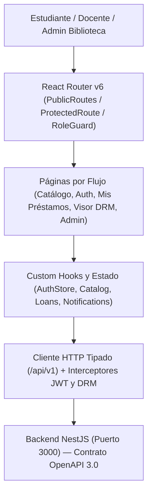

# OpenSpec — Especificación de Frontend, UI/UX (Figma) y Visor DRM (v1.0)

**Sistema:** Sistema de Préstamo Digital Interdepartamental (Repositorio FAUD-UNSJ)  
**Etapa:** Etapa C — Construcción del Frontend SPA (basado en el Contrato OpenAPI `v1.0.0` y Prototipos Figma)  
**Estado:** Aprobada / Lista para Implementación (v1.0)  
**Responsables de Frontend y UI/UX:** Diego A. González (Frontend & PM) · Hugo A. Torrent (Analista Funcional & UI/UX) · Luciano O. Reguera (Integración API & DRM)  
**Gestor de paquetes oficial:** `pnpm`  
**Stack Tecnológico:** React 18+ · Vite · TypeScript · Tailwind CSS · React Router v6 · Lucide Icons · PDF.js (Canvas DRM Renderer)

---

## 1. Propósito y Alcance de la Especificación

Este documento establece la especificación técnica, visual y funcional (bajo metodología **Spec-Driven Development / OpenSpec**) para el desarrollo de la **Single Page Application (SPA)** ubicada en `frontend/`.

El Frontend consume exclusivamente el contrato congelado **OpenAPI 3.0** ([`docs/specs/openapi.json`](file:///c:/Users/Operador/Documents/Luciano/projects/TDS/PPI_IV/docs/specs/openapi.json), 26 endpoints y 50 esquemas DTO) certificado en las Fases 0 a 6 del Backend, materializando el 100% de las pantallas del **Prototipo de Alta Fidelidad en Figma (páginas 7 a 14)** y los diagramas UML de la Segunda Etapa.

---

## 2. Arquitectura Técnica del Frontend (`frontend/`)



### 2.1. Estructura de Directorios Propuesta

```text
frontend/
├── public/                        # Activos estáticos (escudo FAUD-UNSJ, favicon, worker de PDF.js)
├── src/
│   ├── api/                       # Cliente HTTP (axios/fetch), interceptores y servicios por módulo
│   │   ├── http-client.ts         # Instancia base con inyección de Bearer JWT y manejo de 401/403/429
│   │   ├── auth.api.ts            # POST /auth/login, POST /auth/register, GET /auth/profile
│   │   ├── departments.api.ts     # GET /departamentos, GET /departamentos/metricas
│   │   ├── catalog.api.ts         # GET/POST/PATCH/DELETE /documentos
│   │   ├── loans.api.ts           # POST /prestamos, GET /mis-prestamos, GET /:id/visor, PATCH /revocar
│   │   └── notifications.api.ts   # GET /notificaciones, PATCH /:id/leida, POST /ejecutar-control-vigencia
│   ├── types/                     # Contratos TypeScript espejados de docs/specs/openapi.json
│   │   └── openapi.types.ts       # Enumerados, DTOs de respuesta y parámetros de consulta
│   ├── context/                   # Estado global de sesión (AuthContext) y notificaciones (ToastContext)
│   ├── components/
│   │   ├── layout/                # Navbar institucional, Sidebar Admin, Footer FAUD-UNSJ, NotificationBell
│   │   ├── ui/                    # Botones, Badges de estado, Modales, Tabs con contadores, Paginador
│   │   ├── catalog/               # DocumentCard, CatalogFilters, TerritorialBanner
│   │   ├── loans/                 # LoanCard, CountdownBadge, RequestLoanModal
│   │   ├── viewer/                # ProtectedPdfCanvas, DynamicWatermark, DrmSecurityShield
│   │   └── admin/                 # UserValidationTable, DocumentUploadForm, AdminLoansTable
│   ├── pages/
│   │   ├── public/                # CatalogPage (pág. 11), DocumentDetailPage (pág. 12), LoginPage, RegisterPage (pág. 10)
│   │   ├── student/               # MyLoansPage (pág. 13), NotificationsPage, ProtectedViewerPage (pág. 14)
│   │   └── admin/                 # AdminUsersPage (pág. 8), AdminCatalogPage (pág. 7), AdminLoansPage (pág. 9)
│   ├── routes/                    # Configuración de rutas, ProtectedRoute y RoleGuard
│   ├── utils/                     # Formateadores de fechas, cálculo de cuenta regresiva, helpers DRM
│   ├── App.tsx
│   └── main.tsx
├── index.html
├── package.json
├── tailwind.config.js
├── tsconfig.json
└── vite.config.ts
```

---

## 3. Sistema de Diseño Oficial (Design System — Figma FAUD-UNSJ, Páginas 20 a 24)

### 3.1. Marca e Identidad (`01 MARCA E IDENTIDAD` — Figma pág. 21)
- **Logotipo:** Emblema cuadrado Ámbar FAUD (`#FFB606`) con la inicial **`"R"`** en `Inter ExtraBold 800` (color `#1A1A2E`), acompañado del nombre **`Repositorio FAUD`** y subtítulo **`FAUD-UNSJ · Préstamo Digital Interdepartamental`** (o **`Biblioteca FAUD-UNSJ · Admin`** en el sidebar de administración).

### 3.2. Paleta de Colores Institucional y Semántica (`02 PALETA DE COLORES` — Figma pág. 21)

| Categoría | Token / Nombre en Figma | Color Hex | Aplicación en Prototipos Figma |
| :--- | :--- | :--- | :--- |
| **Primario** | **Ámbar FAUD (`Primary`)** | `#FFB606` | Botones primarios (`r:10px`, `h:48px`), acentos, pestañas activas, links destacados, acentos de esquina. |
| **Secundario** | **Oro oscuro (`Secondary`)** | `#E6A303` | Hover, bordes activos, texto de botones secundarios outlined y tags. |
| **Interacción** | **Oro hover** | `#FFCA28` | Estado hover de botones primarios e interacciones. |
| **Fondos Oscuros** | **Navy profundo** | `#1A1A2E` / `#2D2D2D` | Hero principal (pág. 4), panel izquierdo split 50/50 (págs. 5–6), sidebar admin `240px` (págs. 7–9), navbar. |
| **Gradientes / Activo** | **Navy medio** | `#16213E` | Ítem activo de sidebar admin, gradientes oscuros. |
| **Visor / Acento** | **Azul arquitectónico** | `#0F3460` | Barra superior del Visor DRM (pág. 14), badge `Vigente · 5 días`. |
| **Fondo General** | **Crema cálido** | `#FFF9EC` | Fondo principal de toda la aplicación. |
| **Superficie** | **Blanco** | `#FFFFFF` | Tarjetas de catálogo, tablas, formularios y modales (`r:12px`). |
| **Superficie Acento** | **Ámbar claro** | `#FFF3D0` | Tags de palabras clave (`r:16px`, `h:32px`), chips, encabezados suaves. |
| **Bordes** | **Borde cálido** | `#E8DCC8` | Bordes de inputs (`r:8px`, `h:44px`), tarjetas, divisores y pestañas inactivas. |
| **Texto** | **Principal / Secundario / Crema** | `#2D2D2D` / `#6B7280` / `#F5F0E1` | Títulos y body (`#2D2D2D`), subtítulos y labels (`#6B7280`), texto sobre fondo oscuro (`#F5F0E1`). |
| **Estado: Éxito / Activo** | **Disponible / Activo** | Texto `#2D6A4F` · Bg `#E6F4EA` | Badges `Disponible`, `Activo · 5 días`, `Aprobado` (`r:15px`). |
| **Estado: Alerta / Warning** | **Por vencer / Prestado** | Texto `#9A5B00` · Bg `#FFF4E0` | Badges `Por vencer · 1 día`, `Prestado`, `Alerta`, `Pendiente` (`r:15px`). |
| **Estado: Error / Peligro** | **Revocar / Rechazar** | Texto `#B3261E` · Bg `#FDECEA` | Botón outlined `Revocar acceso`, `Rechazar`, errores `403 Forbidden`. |
| **Estado: Inactivo** | **Vencido / Deshabilitado** | Texto `#6B7280` · Bg `#F1F1F1` | Badges `Vencido` y controles deshabilitados (`#E8DCC8` / `#9AA1AE`). |

### 3.3. Tipografía, Layouts y Motivos Arquitectónicos (`03` a `07` — Figma págs. 3, 15, 22, 23 y 24)
- **Familia tipográfica:** `Inter` (`Google Fonts`), pesos `400 Regular`, `500 Medium`, `600 SemiBold`, `700 Bold` y `800 ExtraBold` (reservado para el logotipo `R` y el H1 Hero de `48px`).
- **Escala tipográfica:** `H1 Hero: 48px`, `H2 Página: 28px`, `H3 Sección: 20px`, `H4 Tarjeta: 16px`, `Body: 14px`, `Label: 13px`, `Caption: 12px`, `Overline: 11px (tracking 3px)`.
- **Breakpoints y Layouts (Figma págs. 3, 15 y 24):**
  - **Desktop (`1440 × 900`):** Margen lateral `80px`, contenido máximo `1280px`, Navbar superior `64px`, Sidebar Admin fijo izquierdo `240px`.
  - **Mobile (`375 × 812`):** Margen lateral `20px`, Top bar `56px`, sin sidebar (menú hamburguesa).
  - **Login / Registro (págs. 5 y 6):** Layout **Split 50/50** (panel izquierdo oscuro de marca + panel derecho `#FFF9EC` con formulario).
- **Motivos decorativos arquitectónicos (Figma pág. 24):**
  - **Grid de blueprint:** Patrón sutil de grilla `20px + 100px` que evoca planos arquitectónicos.
  - **Acentos de esquina:** Líneas doradas (`#FFB606`) en esquinas de tarjetas y secciones hero.
  - **Marca de agua DRM:** `"Ana Pérez · Préstamo #1024"`, diagonal `-20°` sobre el visor en tono dorado con `8% opacidad`.

---

## 4. Mapa de Rutas, Roles y Trazabilidad con Figma (Páginas 4 a 19)

| Ruta SPA | Vista / Componente | Acceso / Guard | Pantalla Figma / Diagrama | Endpoints Backend Consumidos |
| :--- | :--- | :--- | :--- | :--- |
| `/` | `LandingPage` | Público | **Figma pág. 4 y 16** (Presentación / Hero Repositorio FAUD) | `GET /api/v1/health`, `GET /api/v1/departamentos/metricas` |
| `/catalogo` | `CatalogPage` | Público | **Figma pág. 11 y 19** (Catálogo de documentos + Filtros) | `GET /api/v1/documentos`, `GET /api/v1/departamentos`, `GET /api/v1/departamentos/metricas` |
| `/documentos/:id` | `DocumentDetailPage` | Público (Acción requiere Auth) | **Figma pág. 12 y 19** (Ficha Bibliográfica + ¿Cómo funciona?) | `GET /api/v1/documentos/:id`, `POST /api/v1/prestamos` |
| `/login` | `LoginPage` | Público (Solo no autenticados) | **Figma pág. 5 y 16** (Iniciar sesión — Split 50/50) | `POST /api/v1/auth/login`, `GET /api/v1/auth/profile` |
| `/registro` | `RegisterPage` | Público (Solo no autenticados) | **Figma pág. 6 y 16** (Crear cuenta — Split 50/50 + 19 Deptos) | `GET /api/v1/departamentos`, `POST /api/v1/auth/register` |
| `/mis-prestamos` | `MyLoansPage` | `JwtAuthGuard` (`USUARIO` / `ADMIN`) | **Figma pág. 13 y 19** (Mis préstamos y Vigencia) | `GET /api/v1/prestamos/mis-prestamos`, `PATCH /api/v1/prestamos/:id/cerrar` |
| `/notificaciones` | `NotificationsPage` | `JwtAuthGuard` (`USUARIO` / `ADMIN`) | **Figma pág. 13** + **RF06** (Bandeja de Avisos 24h) | `GET /api/v1/notificaciones`, `PATCH /api/v1/notificaciones/:id/leida`, `PATCH /api/v1/notificaciones/marcar-todas-leidas` |
| `/visor/:prestamoId` | `ProtectedViewerPage` | `JwtAuthGuard` + Token DRM 7d | **Figma pág. 14 y 19** + **Figura 3** (Visor DRM) | `GET /api/v1/prestamos/:id/visor`, `GET /api/v1/documentos/:id/ver` (o `/prestamos/:id/contenido`) |
| `/admin/catalogo` | `AdminCatalogPage` | `RoleGuard(ADMINISTRADOR)` | **Figma pág. 7 y 16** (Sidebar 240px + Cargar documento) | `POST /api/v1/documentos`, `PATCH /api/v1/documentos/:id`, `DELETE /api/v1/documentos/:id` |
| `/admin/usuarios` | `AdminUsersPage` | `RoleGuard(ADMINISTRADOR)` | **Figma pág. 8 y 17** (Sidebar 240px + Validación de Usuarios) | `GET /api/v1/usuarios`, `PATCH /api/v1/usuarios/:id/estado`, `GET /api/v1/departamentos` |
| `/admin/prestamos` | `AdminLoansPage` | `RoleGuard(ADMINISTRADOR)` | **Figma pág. 9 y 17** (Sidebar 240px + Control y Revocación) | `GET /api/v1/prestamos`, `PATCH /api/v1/prestamos/:id/revocar`, `POST /api/v1/notificaciones/ejecutar-control-vigencia` |

---

## 5. Especificación de Requerimientos Frontend y Escenarios (Given / When / Then)

### Spec FE-01 — Registro Territorial (19 Departamentos) y Validación de Sesión (`RF05` — Figma pág. 10)
- **Reglas de interfaz:**
  1. El formulario de registro obtiene dinámicamente los **19 departamentos de San Juan** desde `GET /api/v1/departamentos`, mostrando `Capital` en primer lugar y destacando el alcance interdepartamental hacia los 18 departamentos restantes.
  2. Tras registrarse (`POST /api/v1/auth/register`), la SPA **no inicia sesión automáticamente**, sino que presenta un estado informativo claro indicando que la cuenta fue creada en estado **`PENDIENTE`** y aguarda validación de la Biblioteca FAUD-UNSJ.
  3. Si un usuario con cuenta `PENDIENTE` o `RECHAZADO` intenta iniciar sesión (`POST /api/v1/auth/login` -> `403 Forbidden`), el formulario muestra una alerta destacada en color ámbar/rojo explicando el motivo institucional devuelto por la API.
  4. Si supera el umbral de Rate Limiting (`429 Too Many Requests`), la interfaz informa el tiempo de espera indicado en `Retry-After`.
- **Escenario 1: Registro exitoso de estudiante de departamento alejado**
  - **Given** un visitante en la vista `/registro`
  - **When** completa nombre, email institucional/personal, contraseña válida, selecciona el departamento `"Jáchal"` y envía el formulario
  - **Then** la SPA invoca `POST /api/v1/auth/register` y renderiza la tarjeta de confirmación `"Cuenta registrada en estado PENDIENTE de validación por Biblioteca"`.
- **Escenario 2: Aviso de bloqueo por cuenta pendiente al iniciar sesión**
  - **Given** un usuario cuya cuenta aún figura como `PENDIENTE`
  - **When** ingresa sus credenciales en `/login`
  - **Then** al recibir `403 Forbidden`, la interfaz muestra el banner informativo de validación pendiente sin redirigir a rutas privadas.

---

### Spec FE-02 — Catálogo Público Interdepartamental y Ficha Bibliográfica (`RF02` — Figma págs. 11 y 12)
- **Reglas de interfaz:**
  1. Cualquier visitante (incluso sin iniciar sesión) puede explorar el catálogo en `/catalogo` y ver el detalle en `/documentos/:id`.
  2. El buscador permite combinar en tiempo real (con *debounce* en texto libre):
     - Búsqueda libre (`q`: título, autor, director, resumen o palabras clave).
     - Selector de **Departamento de Origen** (los 19 departamentos de San Juan).
     - Selector de **Carrera** (`Arquitectura`, `Diseño`, `Urbanismo`).
     - Selector de **Tipo de Documento** (`TESIS`, `MONOGRAFIA`, `INVESTIGACION`, `OTROS`).
     - Rango de **Año de publicación** (`anioDesde`, `anioHasta`) y filtro de **Disponibilidad** (`disponible`).
  3. En la **Ficha Bibliográfica (`/documentos/:id`, Figma pág. 12)** se muestran todos los metadatos normalizados, las condiciones del préstamo digital (7 días corridos, lectura en visor protegido con marca de agua, sin descarga local) y un botón de acción contextual:
     - Si el visitante **no está autenticado**: botón `"Iniciar sesión para solicitar préstamo (7 días)"` que redirige a `/login?redirect=/documentos/:id`.
     - Si el usuario autenticado **ya posee un préstamo `ACTIVO`** sobre ese documento: botón verde `"Ya tenés un préstamo activo · Abrir en Visor Protegido"` que lleva directamente a `/visor/:prestamoId`.
     - Si el documento está **habilitado (`estaDisponible = true`)**: botón primario `"Solicitar Préstamo Digital (7 días)"`.
     - Si el documento está **suspendido por Biblioteca (`disponible = false`)**: botón deshabilitado con leyenda `"Material temporalmente no disponible por Biblioteca"`.

---

### Spec FE-03 — Solicitud de Préstamo, Panel `"Mis Préstamos"` y Bandeja de Notificaciones (`RF03`, `RF06` — Figma pág. 13)
- **Reglas de interfaz:**
  1. Al confirmar `"Solicitar Préstamo Digital (7 días)"`, la SPA ejecuta `POST /api/v1/prestamos` con `{ documentoId }`. Al recibir `201 Created`, almacena en sesión/estado el `tokenAcceso` DRM de 7 días y ofrece abrir inmediatamente el **Visor Protegido** o ir a **`/mis-prestamos`**.
  2. La vista **`/mis-prestamos` (Figma pág. 13)** presenta pestañas con los contadores provistos por `GET /api/v1/prestamos/mis-prestamos`:
     - `Activos (N)`
     - `Por Vencer 24h (N)` (con indicador visual ámbar de alerta temprana `RF06`)
     - `Vencidos / Historial (N)` (`VENCIDO`, `REVOCADO`, `CERRADO`)
  3. Cada tarjeta de préstamo activo muestra: código formateado (`#1024`), título y autor de la obra, fecha de inicio y vencimiento, barra/badge de cuenta regresiva (`diasRestantes` y `horasRestantes`), botón primario **`"Leer en Visor Protegido"`** y botón secundario **`"Devolver / Cerrar Préstamo"`** (`PATCH /api/v1/prestamos/:id/cerrar`).
  4. La barra superior incluye la **Campana de Notificaciones (`NotificationBell`)** con el badge numérico `noLeidas` (`GET /api/v1/notificaciones`), desplegando los avisos (`PRESTAMO_OTORGADO`, `PROXIMO_VENCIMIENTO_24H`, `PRESTAMO_VENCIDO`, `PRESTAMO_REVOCADO`, `CUENTA_APROBADA`) y permitiendo marcarlos como leídos individual o masivamente.

---

### Spec FE-04 — Visor PDF Protegido con DRM Temporal y Marca de Agua Dinámica (`RF04`, `RNF02` — Figma pág. 14 y Figura 3)
- **Reglas de interfaz y seguridad DRM:**
  1. **Doble Validación al Ingresar (`/visor/:prestamoId`):**
     - Primero consulta `GET /api/v1/prestamos/:id/visor` enviando el token DRM (`x-drm-token` / `Authorization`) para obtener los metadatos validados en tiempo real (`marcaAgua`, `segundosRestantes`, `drm.permitirDescarga = false`, `drm.permitirImpresion = false`, datos de la obra).
     - A continuación descarga en memoria (`ArrayBuffer` / `Uint8Array`) el stream binario desde `GET /api/v1/documentos/:documentoId/ver` (Diagrama de Secuencia — Figura 3) enviando los encabezados de autenticación y DRM, **sin exponer nunca una URL pública ni abrir el visor PDF nativo del navegador** (evitando los botones nativos de descarga e impresión de Chrome/Edge/Firefox).
  2. **Renderizado en `<canvas>` con Superposición de Marca de Agua Dinámica:**
     - Las páginas del PDF se renderizan sobre elementos `<canvas>` controlados con controles propios de paginación (`Página X de Y`) y zoom (`-`, `100%`, `+`).
     - Sobre el lienzo del documento se renderiza una **capa de Marca de Agua Dinámica inalterable** (`pointer-events-none select-none`) repetida en patrón diagonal con la leyenda exacta devuelta por el backend (`X-DRM-Watermark` / `metadata.marcaAgua`):
       > `"Ana Pérez · Préstamo #1024 · FAUD-UNSJ"`
  3. **Escudo de Bloqueo en Cliente (`DrmSecurityShield` — `RNF02`):**
     - Bloqueo de menú contextual (`onContextMenu -> preventDefault()`).
     - Bloqueo de atajos de teclado de descarga, guardado, impresión y copia (`Ctrl+S`, `Ctrl+P`, `Ctrl+C`, `Cmd+S`, `Cmd+P`).
     - Regla CSS `@media print { body { display: none !important; } }` que oculta el documento si el usuario intenta imprimir desde el menú del navegador.
  4. **Verificación Periódica y Bloqueo Inmediato (`403 Forbidden`):**
     - El visor mantiene un temporizador de cuenta regresiva en vivo y revalida periódicamente la vigencia contra el backend.
     - Si el plazo de 7 días expira o si el Administrador revoca el préstamo (`403 Forbidden`: `"El préstamo ha vencido o fue revocado"`), el visor limpia inmediatamente el buffer del PDF de la memoria y muestra la **Pantalla de Acceso Bloqueado por DRM**, con opción de regresar a `/mis-prestamos` o `/catalogo`.

---

### Spec FE-05 — Panel de Administración de Biblioteca FAUD-UNSJ (`RF01`, `RF04`, `RF05`, `RF06` — Figma págs. 7, 8 y 9)
- **Reglas de interfaz:**
  1. **Validación de Usuarios por Departamento (`/admin/usuarios` — Figma pág. 8):**
     - Consume `GET /api/v1/usuarios` mostrando las 4 pestañas con contadores en tiempo real: `Todos`, `Pendientes`, `Aprobados` y `Rechazados`.
     - Permite filtrar por cualquiera de los **19 departamentos de San Juan** y buscar por nombre o email.
     - Incluye botones de acción rápida **`Aprobar`** y **`Rechazar`** (con modal opcional de motivo/observación) que invocan `PATCH /api/v1/usuarios/:id/estado` y actualizan inmediatamente los contadores.
  2. **Carga y Gestión del Catálogo PDF (`/admin/catalogo` — Figma pág. 7):**
     - Formulario de alta (`POST /api/v1/documentos`, `multipart/form-data`) con selector Drag & Drop de archivo `.pdf` (validando en cliente extensión `.pdf` y peso `<= 50 MB` antes de subir) y campos normalizados (`titulo`, `autor`, `director`, `carrera`, `tipo`, `anio`, `departamentoOrigenId`, `palabrasClave`, `resumen`).
     - Tabla de gestión del catálogo existente con acciones para **Editar metadatos / reemplazar PDF** (`PATCH /api/v1/documentos/:id`), **Suspender / Habilitar disponibilidad** (`disponible: true/false`) y **Eliminar documento** (`DELETE /api/v1/documentos/:id`).
  3. **Tablero de Control de Préstamos y Revocación DRM (`/admin/prestamos` — Figma pág. 9):**
     - Consume `GET /api/v1/prestamos` renderizando las tarjetas de métricas superiores: **`Préstamos Activos`**, **`Por Vencer (24h)`**, **`Vencidos Hoy`**, **`Revocados`** y **`Total Histórico`**.
     - Tabla paginada con filtros por estado (`ACTIVO`, `VENCIDO`, `REVOCADO`, etc.), departamento y búsqueda libre.
     - Para cada préstamo `ACTIVO`, ofrece el botón **`"Revocar Acceso"`** (`PATCH /api/v1/prestamos/:id/revocar` con motivo de auditoría), cortando en el acto el acceso al visor PDF del usuario.
     - Incluye el botón operativo **`"Ejecutar Control de Vigencia y Alertas 24h"`** (`POST /api/v1/notificaciones/ejecutar-control-vigencia`), que permite durante la defensa/demostración académica disparar en vivo el proceso del Diagrama de Actividades (Figura 4) y visualizar el resumen de préstamos vencidos y correos enviados a Mailpit.
